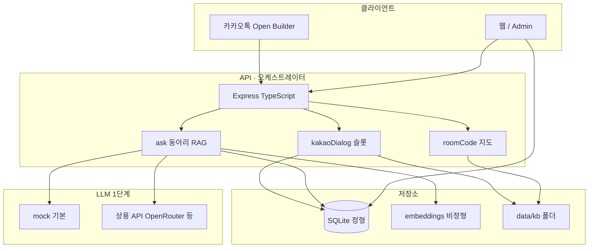
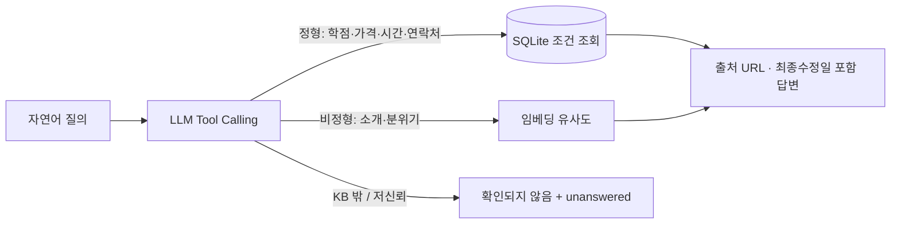
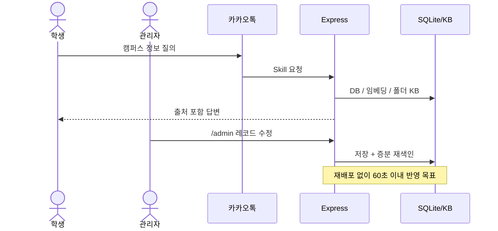

# 시스템 아키텍처 (1차 발표 정렬)

실제 구현: **Kakao Open Builder + Express + SQLite + `data/kb` + Admin UI + 호실 코드**.  
발표 Slide 9–10의 하이브리드·구성도와 대응시킨다.

## 시스템 개요

### [현재] vs [이후] (Slide 10)

| 라벨 | 내용 |
|------|------|
| **[현재]** | 동아리 KB · 관리자 · 상용 LLM (+ 졸업요건 폴더 KB, 호실 코드, 터널 호스팅) |
| **[이후]** | 추가 도메인(식당 등) · 로컬 sLLM · 학교/고정 호스팅 |

## 하이브리드 검색 흐름 (Slide 9)

- **정형** — 값의 정확성이 필수 → DB  
- **비정형** — 의미 기반 탐색 → Vector/embeddings  
- 임계값 미만 → **"확인되지 않음"**

## 단순 유스케이스

더 자세한 경로·테이블: [ARCHITECTURE.md](../ARCHITECTURE.md)  
아티팩트 stubs: [artifacts/](./artifacts/)
