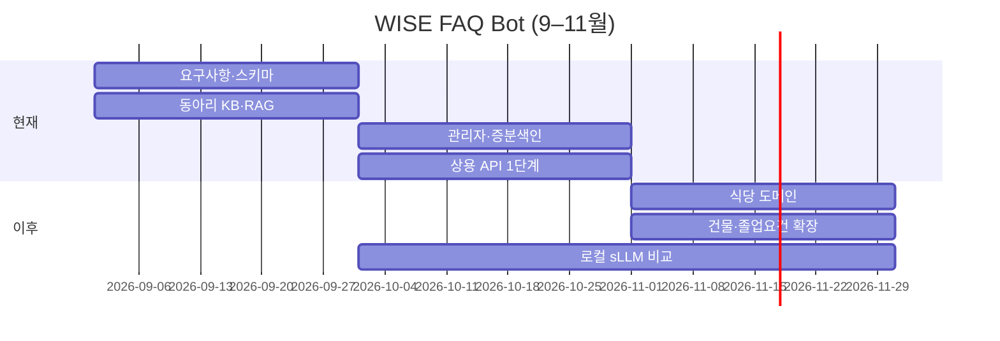

# Gantt stub (1차 발표 Slide 7)

기간: 9월 ~ 11월. **『현재 구현 범위』** vs **『이후 확장』** 라벨.

| 작업 항목 | 9월 | 10월 | 11월 | 구분 |
|-----------|-----|------|------|------|
| 요구사항·스키마 설계 | ■■■ | ■ |  | 현재 |
| 동아리 KB · RAG 파이프라인 | ■■ | ■■■ |  | 현재 |
| 관리자 수정 / 증분 색인 |  | ■■■ | ■ | 현재 |
| 상용 API 1단계 검증 |  | ■■ | ■ | 현재 |
| 학생식당 도메인 확장 |  |  | ■■ | 이후 |
| 건물·강의실 → 졸업요건 |  |  | ■■ | 이후 |
| 로컬 sLLM 비교 (2단계) |  | ■ | ■■■ | 이후 |

- **현재:** 동아리 도메인 QA · 관리자 수정/증분색인 · 상용 API 1단계  
- **이후:** 학생식당 → 건물·강의실 → 졸업요건, 로컬 sLLM 비교(2단계)  
- ※ 저장소에는 졸업요건·지도가 슬롯/폴더 KB로 이미 있음 — 간트 "이후"는 Hybrid 스키마 정식 확장 기준 ([scope.md](../scope.md))

