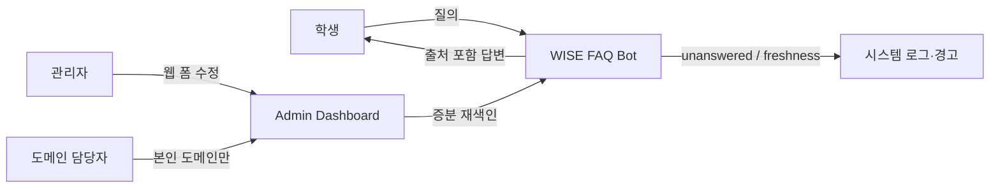

# Use case stub (1차 발표 Slide 6)

| 액터 | 유스케이스 |
|------|------------|
| 학생 | 자연어로 캠퍼스 정보 질의 → 출처 포함 답변 수신 |
| 관리자 (교직원·학생회) | 웹 폼에서 레코드 수정 → 재배포 없이 답변 반영 |
| 도메인 담당자 | 본인 도메인 데이터만 편집 |
| 시스템 | 미응답 질문 수집, 오래된 데이터 경고 표시 |

구현 매핑: Kakao Skill(학생) · `/admin`(관리자) · unanswered API(시스템).
