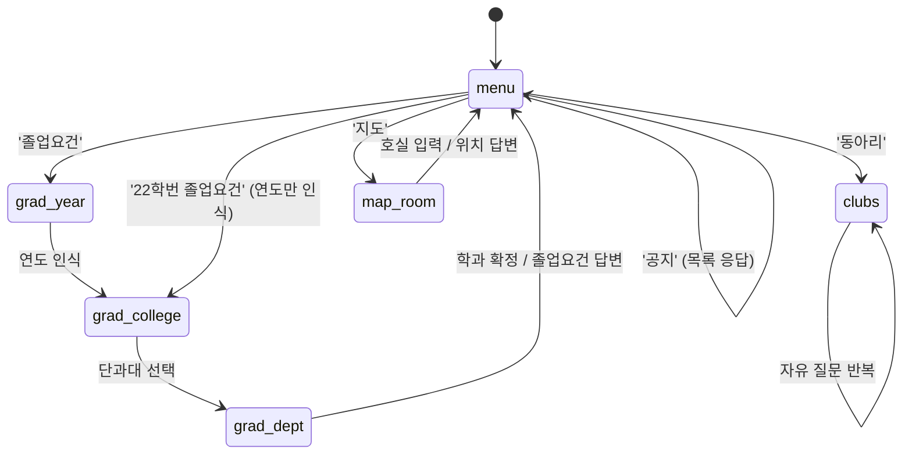

# 상태 다이어그램 — 카카오톡 대화 흐름

대화 상태는 `kakao_sessions.flow` 컬럼에 사용자별로 저장된다.

## 전이 규칙

- **전역 전이**: 모든 상태에서 '메뉴' → `menu`, '졸업요건' → `grad_year`
- **자기 전이**: 입력 해석 실패 시 같은 상태를 유지하고 예시·후보 버튼을 다시 제시한다
- 답변을 마치면 상태를 `menu` 로 초기화한다
