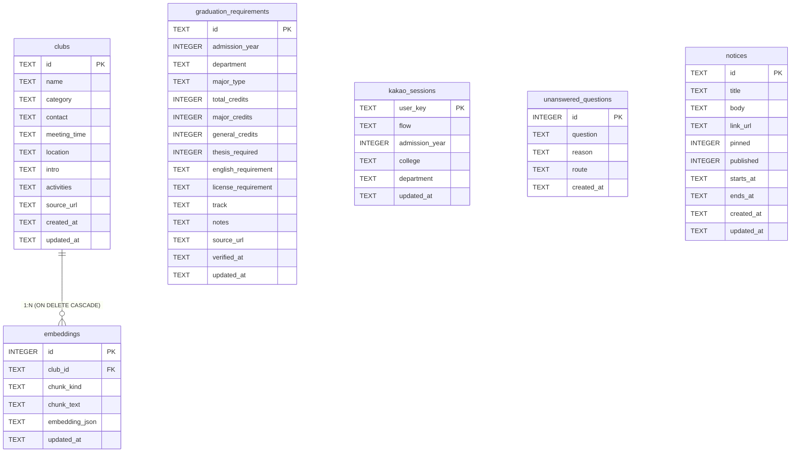

# 데이터 설계 — ERD · 테이블 명세

## TBL-01 clubs

| 컬럼 | 타입 | 제약 | 설명 |
|------|------|------|------|
| id | TEXT | PK | UUID |
| name | TEXT | NOT NULL, IDX | 동아리명 |
| category | TEXT | NOT NULL, IDX | 분과(학술·봉사 등) |
| contact | TEXT | NULL | 연락처 |
| meeting_time | TEXT | NULL | 정기 모임 |
| location | TEXT | NULL | 장소 |
| intro | TEXT | NOT NULL | 소개 (색인 대상) |
| activities | TEXT | NOT NULL | 활동 (색인 대상) |
| source_url | TEXT | NOT NULL | 출처 URL |
| created_at | TEXT | NOT NULL | 생성 시각 (ISO) |
| updated_at | TEXT | NOT NULL | 갱신 시각 (출처 표기용) |

## TBL-02 embeddings

| 컬럼 | 타입 | 제약 | 설명 |
|------|------|------|------|
| id | INTEGER | PK, AUTO | 청크 번호 |
| club_id | TEXT | FK → clubs.id, CASCADE | 소속 동아리 |
| chunk_kind | TEXT | NOT NULL | intro / activities / combined |
| chunk_text | TEXT | NOT NULL | 색인 원문 |
| embedding_json | TEXT | NOT NULL | 벡터(JSON 배열) |
| updated_at | TEXT | NOT NULL | 색인 시각 |

## TBL-03 kakao_sessions

| 컬럼 | 타입 | 제약 | 설명 |
|------|------|------|------|
| user_key | TEXT | PK | 카톡 사용자 ID |
| flow | TEXT | NOT NULL, 기본 'menu' | 대화 상태 |
| admission_year | INTEGER | NULL | 선택한 입학연도 |
| college | TEXT | NULL | 선택한 단과대 |
| department | TEXT | NULL | 선택한 학과 |
| updated_at | TEXT | NOT NULL | 갱신 시각 |

## TBL-04 graduation_requirements

| 컬럼 | 타입 | 제약 | 설명 |
|------|------|------|------|
| id | TEXT | PK | UUID |
| admission_year | INTEGER | NOT NULL, UQ | 입학연도 |
| department | TEXT | NOT NULL, UQ | 학과·전공 |
| major_type | TEXT | UQ | 전공 구분 |
| total_credits | INTEGER | NULL | 졸업 학점 |
| major_credits | INTEGER | NULL | 전공 학점 |
| general_credits | INTEGER | NULL | 교양 학점 |
| thesis_required | INTEGER | 0/1 | 논문·졸업작품 |
| english_requirement | TEXT | NULL | 외국어 요건 |
| license_requirement | TEXT | NULL | 자격증 요건 |
| track | TEXT | NULL | 트랙 |
| notes | TEXT | NULL | 비고 |
| source_url | TEXT | NULL | 원문 경로·URL |
| verified_at | TEXT | NULL | 검증일 |
| updated_at | TEXT | NOT NULL | 갱신 시각 |

UNIQUE(admission_year, department, major_type)

## TBL-05 unanswered_questions

| 컬럼 | 타입 | 제약 | 설명 |
|------|------|------|------|
| id | INTEGER | PK, AUTO | 로그 번호 |
| question | TEXT | NOT NULL | 원 질문 |
| reason | TEXT | NOT NULL | 실패 사유 |
| route | TEXT | NULL | 경로(graduation 등) |
| created_at | TEXT | NOT NULL, IDX | 기록 시각 |

## TBL-06 notices (구현 예정)

| 컬럼 | 타입 | 제약 | 설명 |
|------|------|------|------|
| id | TEXT | PK | UUID |
| title | TEXT | NOT NULL | 제목 |
| body | TEXT | NOT NULL | 본문 |
| link_url | TEXT | NULL, http(s)만 허용 | 원문 링크 |
| pinned | INTEGER | 0/1, 기본 0 | 상단 고정 |
| published | INTEGER | 0/1, 기본 1 | 게시 여부 |
| starts_at / ends_at | TEXT | NULL | 게시 기간 |
| created_at / updated_at | TEXT | NOT NULL | 생성·갱신 시각 |

## 설계 결정

- 졸업요건은 폴더 KB를 우선 조회하고 없으면 DB를 조회한다(원문 PDF 보존).
- 세션·로그 테이블은 도메인과 독립이므로 도메인 추가 시 스키마 영향이 없다.
- 벡터는 JSON 텍스트로 저장한다(규모상 전용 벡터 DB 불필요).
- 폴더 KB(`data/kb`)는 DB 밖의 파일 트리다.
