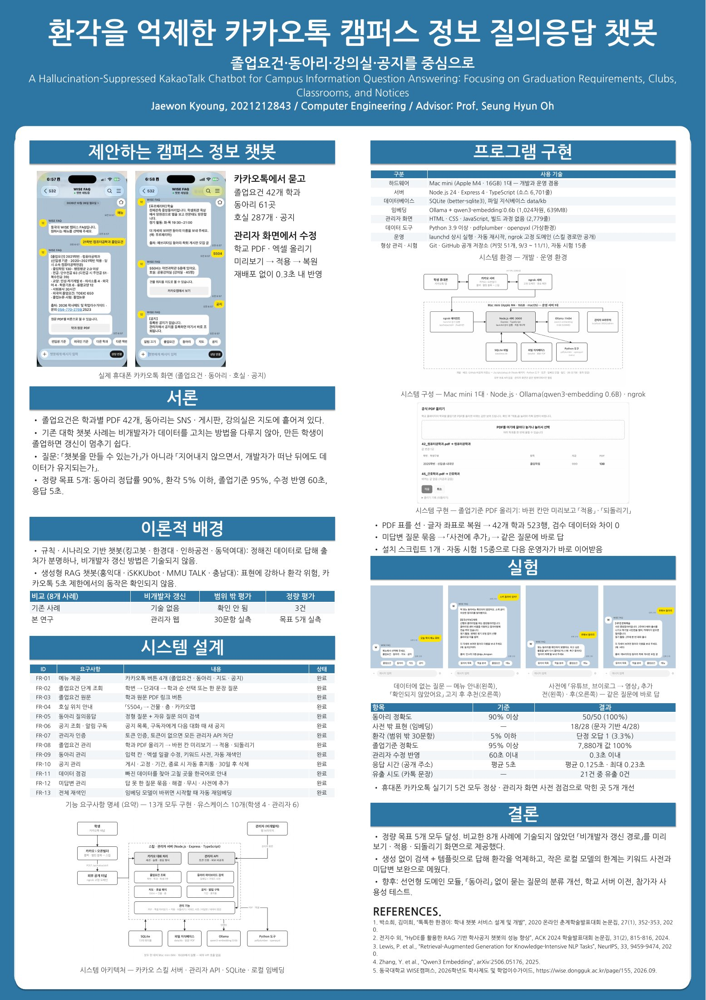

# A1 포스터

> 2026-11-13 학과에 제출한 A1 포스터(594 × 841 mm, v6)입니다. 아래 글자와 표는 포스터 pptx 에서 옮겼습니다.
> 다시 만들기: `python3 tools/thesis/build_poster.py <학과 붙임3-b 양식.pptx> <출력.pptx> --v6`

## 환각을 억제한 카카오톡 캠퍼스 정보 질의응답 챗봇

졸업요건·동아리·강의실·공지를 중심으로

A Hallucination-Suppressed KakaoTalk Chatbot for Campus Information Question Answering: Focusing on Graduation Requirements, Clubs, Classrooms, and Notices

Jaewon Kyoung, 2021212843 / Computer Engineering / Advisor: Prof. Seung Hyun Oh

제안하는 캠퍼스 정보 챗봇

- 카카오톡에서 묻고
- 졸업요건 42개 학과
- 동아리 61곳
- 호실 287개 · 공지
- 관리자 화면에서 수정
- 학교 PDF · 엑셀 올리기
- 미리보기 → 적용 → 복원
- 재배포 없이 0.3초 내 반영

실제 휴대폰 카카오톡 화면 (졸업요건 · 동아리 · 호실 · 공지)

서론

- 졸업요건은 학과별 PDF 42개, 동아리는 SNS · 게시판, 강의실은 지도에 흩어져 있다.
- 기존 대학 챗봇 사례는 비개발자가 데이터를 고치는 방법을 다루지 않아, 만든 학생이 졸업하면 갱신이 멈추기 쉽다.
- 질문: 「챗봇을 만들 수 있는가」가 아니라 「지어내지 않으면서, 개발자가 떠난 뒤에도 데이터가 유지되는가」.
- 정량 목표 5개: 동아리 정답률 90%, 환각 5% 이하, 졸업기준 95%, 수정 반영 60초, 응답 5초.

이론적 배경

- 규칙 · 시나리오 기반 챗봇(킹고봇 · 한경대 · 인하공전 · 동덕여대): 정해진 데이터로 답해 출처가 분명하나, 비개발자 갱신 방법은 기술되지 않음.
- 생성형 RAG 챗봇(홍익대 · iSKKUbot · MMU TALK · 충남대): 표현에 강하나 환각 위험, 카카오톡 5초 제한에서의 동작은 확인되지 않음.

| 비교 (8개 사례) | 비개발자 갱신 | 범위 밖 평가 | 정량 평가 |
|---|---|---|---|
| 기존 사례 | 기술 없음 | 확인 안 됨 | 3건 |
| 본 연구 | 관리자 웹 | 30문항 실측 | 목표 5개 실측 |

시스템 설계

| ID | 요구사항 | 내용 | 상태 |
|---|---|---|---|
| FR-01 | 메뉴 제공 | 카카오톡 버튼 4개 (졸업요건 · 동아리 · 지도 · 공지) | 완료 |
| FR-02 | 졸업요건 단계 조회 | 학번 → 단과대 → 학과 순 선택 또는 한 문장 질문 | 완료 |
| FR-03 | 졸업요건 원문 | 학과 원문 PDF 링크 버튼 | 완료 |
| FR-04 | 호실 위치 안내 | 「S504」 → 건물 · 층 · 카카오맵 | 완료 |
| FR-05 | 동아리 질의응답 | 정형 질문 + 자유 질문 의미 검색 | 완료 |
| FR-06 | 공지 조회 · 알림 구독 | 공지 목록, 구독자에게 다음 대화 때 새 공지 | 완료 |
| FR-07 | 관리자 인증 | 토큰 인증, 토큰이 없으면 모든 관리자 API 차단 | 완료 |
| FR-08 | 졸업요건 관리 | 학과 PDF 올리기 → 바뀐 칸 미리보기 → 적용 · 되돌리기 | 완료 |
| FR-09 | 동아리 관리 | 입력 칸 · 엑셀 일괄 수정, 키워드 사전, 자동 재색인 | 완료 |
| FR-10 | 공지 관리 | 게시 · 고정 · 기간, 종료 시 자동 휴지통 · 30일 후 삭제 | 완료 |
| FR-11 | 데이터 점검 | 빠진 데이터를 찾아 고칠 곳을 한국어로 안내 | 완료 |
| FR-12 | 미답변 관리 | 답 못 한 질문 묶음 · 해결 · 무시 · 사전에 추가 | 완료 |
| FR-13 | 전체 재색인 | 임베딩 모델이 바뀌면 시작할 때 자동 재임베딩 | 완료 |

기능 요구사항 명세 (요약) — 13개 모두 구현 · 유스케이스 10개(학생 4 · 관리자 6)

시스템 아키텍처 — 카카오 스킬 서버 · 관리자 API · SQLite · 로컬 임베딩

프로그램 구현

| 구분 | 사용 기술 |
|---|---|
| 하드웨어 | Mac mini (Apple M4 · 16GB) 1대 — 개발과 운영 겸용 |
| 서버 | Node.js 24 · Express 4 · TypeScript (소스 6,701줄) |
| 데이터베이스 | SQLite (better-sqlite3), 파일 지식베이스 data/kb |
| 임베딩 | Ollama + qwen3-embedding:0.6b (1,024차원, 639MB) |
| 관리자 화면 | HTML · CSS · JavaScript, 빌드 과정 없음 (2,779줄) |
| 데이터 도구 | Python 3.9 이상 · pdfplumber · openpyxl (가상환경) |
| 운영 | launchd 상시 실행 · 자동 재시작, ngrok 고정 도메인 (스킬 경로만 공개) |
| 형상 관리 · 시험 | Git · GitHub 공개 저장소 (커밋 51개, 9/3 ~ 11/1), 자동 시험 15종 |

시스템 환경 — 개발 · 운영 환경

시스템 구성 — Mac mini 1대 · Node.js · Ollama(qwen3-embedding 0.6B) · ngrok

시스템 구현 — 졸업기준 PDF 올리기: 바뀐 칸만 미리보고 「적용」 · 「되돌리기」

- PDF 표를 선 · 글자 좌표로 복원 → 42개 학과 523행, 검수 데이터와 차이 0
- 미답변 질문 묶음 → 「사전에 추가」 → 같은 질문에 바로 답
- 설치 스크립트 1개 · 자동 시험 15종으로 다음 운영자가 바로 이어받음

실험

- 데이터에 없는 질문 — 메뉴 안내(왼쪽),
- 「확인되지 않았어요」 고지 후 추천(오른쪽)

- 사전에 「유튜브, 브이로그 → 영상」 추가
- 전(왼쪽) · 후(오른쪽) — 같은 질문에 바로 답

| 항목 | 기준 | 결과 |
|---|---|---|
| 동아리 정확도 | 90% 이상 | 50/50 (100%) |
| 사전 밖 표현 (임베딩) | — | 18/28 (문자 기반 4/28) |
| 환각 (범위 밖 30문항) | 5% 이하 | 단정 오답 1 (3.3%) |
| 졸업기준 정확도 | 95% 이상 | 7,880개 값 100% |
| 관리자 수정 반영 | 60초 이내 | 0.3초 이내 |
| 응답 시간 (공개 주소) | 평균 5초 | 평균 0.125초 · 최대 0.23초 |
| 유출 시도 (카톡 문장) | — | 21건 중 유출 0건 |

휴대폰 카카오톡 실기기 5건 모두 정상 · 관리자 화면 사전 점검으로 막힌 곳 5개 개선

결론

- 정량 목표 5개 모두 달성. 비교한 8개 사례에 기술되지 않았던 「비개발자 갱신 경로」를 미리보기 · 적용 · 되돌리기 화면으로 제공했다.
- 생성 없이 검색 + 템플릿으로 답해 환각을 억제하고, 작은 로컬 모델의 한계는 키워드 사전과 미답변 보완으로 메웠다.
- 향후: 선언형 도메인 모듈, 「동아리」 없이 묻는 질문의 분류 개선, 학교 서버 이전, 참가자 사용성 테스트.

REFERENCES.

- 1. 박소희, 김미희, “톡톡한 한경이: 학내 챗봇 서비스 설계 및 개발”, 2020 온라인 춘계학술발표대회 논문집, 27(1), 352-353, 2020.
- 2. 전지수 외, “HyDE를 활용한 RAG 기반 학사공지 챗봇의 성능 향상”, ACK 2024 학술발표대회 논문집, 31(2), 815-816, 2024.
- 3. Lewis, P. et al., “Retrieval-Augmented Generation for Knowledge-Intensive NLP Tasks”, NeurIPS, 33, 9459-9474, 2020.
- 4. Zhang, Y. et al., “Qwen3 Embedding”, arXiv:2506.05176, 2025.
- 5. 동국대학교 WISE캠퍼스, 2026학년도 학사제도 및 학업이수가이드, https://wise.dongguk.ac.kr/page/155, 2026.09.

(화면 캡처 9장)
